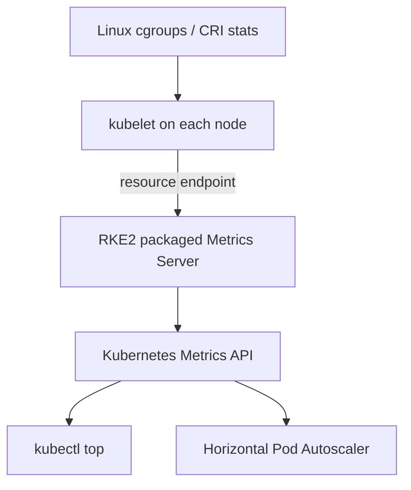

## Overview



| Question | Useful evidence |
| --- | --- |
| Which Pod currently uses the most CPU? | `kubectl top pod` |
| Which container inside a Pod uses the memory? | `kubectl top pod --containers` |
| Why did a container restart? | Pod status, last termination state, and events |
| Was CPU usage high fifteen minutes ago? | A time-series monitoring system |
| Is the container being CPU-throttled? | cgroup or Prometheus container metrics |
| Is Metrics Server itself unhealthy? | APIService status, Deployment status, and logs |

To find answers to these questions, the monitoring system depends on
collection, transport, storage, query, and interpretation capabilities.



## Start the Monitoring Workload



```bash
kubectl create namespace rke2-monitoring
kubectl get namespace rke2-monitoring
```

All workload resources used in this lecture belong in this namespace.





Create `resource-observer.yaml`:

```yaml
apiVersion: v1
kind: Pod
metadata:
  name: resource-observer
  namespace: rke2-monitoring
  labels:
    app: resource-observer
spec:
  restartPolicy: Always
  containers:
    - name: web
      image: nginx:1.27-alpine
      ports:
        - containerPort: 80
      resources:
        requests:
          cpu: 20m
          memory: 24Mi
        limits:
          cpu: 100m
          memory: 64Mi

    - name: cpu-worker
      image: busybox:1.36
      command:
        - /bin/sh
        - -c
        - |
          echo "Starting bounded CPU workload"
          while true; do
            i=0
            while [ "$i" -lt 50000 ]; do
              i=$((i + 1))
            done
          done
      resources:
        requests:
          cpu: 50m
          memory: 8Mi
        limits:
          cpu: 200m
          memory: 32Mi

    - name: memory-holder
      image: busybox:1.36
      command:
        - /bin/sh
        - -c
        - |
          echo "Allocating a file in a memory-backed volume"
          dd if=/dev/zero of=/memory/payload bs=1M count=48
          sleep 36000
      volumeMounts:
        - name: memory-data
          mountPath: /memory
      resources:
        requests:
          cpu: 5m
          memory: 16Mi
        limits:
          cpu: 50m
          memory: 96Mi
  volumes:
    - name: memory-data
      emptyDir:
        medium: Memory
        sizeLimit: 64Mi
```

Deploy the pod

```bash
kubectl apply -f resource-observer.yaml
kubectl -n rke2-monitoring wait --for=condition=Ready pod/resource-observer --timeout=120s
kubectl -n rke2-monitoring get pod resource-observer -o wide
```

{% include figure.liquid path="assets/img/courses/csc478/resource-observation/launch-observer.png" max-width="50%" zoomable=true %}


The containers provide three different behaviors:

- `web` provides a low-usage application container;
- `cpu-worker` continuously requests CPU time but is limited to `200m`;
- `memory-holder` writes `48Mi` to a memory-backed volume.

The resource limits bound the load generated by this hands-on exercise.







1. Linux cgroups and the container runtime account for container usage.
2. The kubelet exposes node, Pod, and container resource metrics.
3. Metrics Server periodically collects those metrics from each kubelet.
4. Metrics Server publishes them through the Kubernetes API aggregation layer.
5. `kubectl top` and autoscalers query the Metrics API.

This pipeline primarily exposes:

- CPU usage;
- memory working-set usage;
- the measurement timestamp and window.

It does not provide a long-term history, application request rates, traces, or
logs.





**CPU**

- `1` CPU is one Kubernetes CPU unit.
- `1000m` is one CPU; `250m` is one quarter of a CPU.
- A value from `kubectl top` represents recent consumption.
- CPU is measured over a time window.
  - A short usage spike may be averaged out.

**Memory**

- Memory is normally displayed in `Ki`, `Mi`, or `Gi`.
- Metrics Server reports a working-set-oriented value.
- Memory usage is not the same as a container's request or limit.
- Reaching a memory limit can cause the kernel to terminate a process with an
  out-of-memory event.





- Requests and limits are configuration. 
- Current and historical usage are measurements.

| Value | Source | Purpose |
| --- | --- | --- |
| Request | `resources.requests` in the Pod specification | The scheduler uses it when choosing a node |
| Limit | `resources.limits` in the Pod specification | The runtime enforces it with Linux cgroups |
| Current usage | Runtime/cgroup statistics collected through the kubelet and Metrics Server | Shows recent CPU and memory use |
| Historical usage | Samples stored by Prometheus or another monitoring system | Shows changes over time |



Inspect the resource configuration of all three containers:

```bash
kubectl -n rke2-monitoring get pod resource-observer -o jsonpath='{range .spec.containers[*]}{.name}{"\n  requests: "}{.resources.requests}{"\n  limits:   "}{.resources.limits}{"\n\n"}{end}'
```

- The scheduler used these requests when placing `resource-observer`.
- The runtime applies the limits separately to each container.
- The `cpu-worker` CPU limit is `200m`.
- The `memory-holder` memory limit is `96Mi`.
- Neither value reports actual consumption.





The node measures container usage. The kubelet exposes the measurements,
Metrics Server collects them, and `kubectl top` displays them:

```bash
kubectl top pod resource-observer -n rke2-monitoring --containers
```

{% include figure.liquid path="assets/img/courses/csc478/resource-observation/current-usage.png" max-width="50%" zoomable=true %}

- Actual values from the hands-on will differ. 
- The expected pattern is that `cpu-worker` uses the most CPU and `memory-holder` uses the most memory. 
- Metrics Server does not preserve earlier samples.






Prometheus or another monitoring system can collect and store repeated samples:

```text
TIME    CONTAINER       CPU    MEMORY
10:00   cpu-worker      195m   1Mi
10:00   memory-holder   1m     49Mi
10:05   cpu-worker      199m   1Mi
10:05   memory-holder   1m     49Mi
```

This history can show whether usage is stable, increasing, or temporary.



### Example interpretation

For the illustrative output above:

- `cpu-worker` uses more than its `50m` request. This is allowed.
- Its usage is close to, but does not directly prove throttling at, its `200m`
  limit.
- `memory-holder` uses more than its `16Mi` request.
- Its usage remains below its `96Mi` limit.

- Historical measurements are needed before changing the request or limit.



## RKE2 Metrics Server



RKE2 distributes Metrics Server as a packaged component named
`rke2-metrics-server`.

On an RKE2 server, packaged component manifests are managed below:

```text
/var/lib/rancher/rke2/server/manifests/
```

RKE2 rewrites packaged manifests when the service starts. Do not directly edit
those generated files. RKE2 configuration or the supported chart customization
mechanism should be used when a packaged component must be changed.

The component can be disabled through RKE2 server configuration:

```yaml
disable:
  - rke2-metrics-server
```

Disabling a packaged component actively removes it. This hands-on exercise
assumes it is not disabled.





Metrics Server supplies current CPU and memory measurements for:

- `kubectl top`;
- Horizontal Pod Autoscaler;
- Vertical Pod Autoscaler;
- basic current-state inspection.

It is not a replacement for Prometheus or another monitoring platform.

| Capability | Metrics Server | Prometheus-style monitoring |
| --- | --- | --- |
| Current node CPU and memory | Yes | Yes |
| Current Pod/container CPU and memory | Yes | Yes |
| Historical queries | No | Yes |
| Dashboards | No | Yes |
| Alert rules | No | Yes |
| Application metrics | No | Yes, when exported and scraped |
| Detailed throttling/restart series | No | Yes, when collected |





In an HA design, server nodes may be tainted so ordinary workloads do not run
on them. If every available node is restricted to critical add-ons, Metrics
Server can remain `Pending` until an eligible agent node is added.

Always inspect the actual scheduling event:

```bash
kubectl -n kube-system describe pod -l app.kubernetes.io/name=rke2-metrics-server
kubectl -n kube-system get pods -l app.kubernetes.io/name=rke2-metrics-server -o wide
```



## Validate the Resource Metrics Pipeline



Resource metrics behavior depends on the RKE2, Kubernetes, and Metrics Server
versions. 

```bash
kubectl version
kubectl get nodes -o wide
kubectl -n kube-system get deployment rke2-metrics-server -o jsonpath='{.spec.template.spec.containers[0].image}{"\n"}'
```





```bash
kubectl -n kube-system get addons.k3s.cattle.io | grep metrics
kubectl -n kube-system get deployment rke2-metrics-server
kubectl -n kube-system get pods -l app.kubernetes.io/name=rke2-metrics-server -o wide
```

The expected state is:

- the add-on exists;
- the Deployment has an available replica;
- the Pod is `Running` and ready;
- the Pod has been scheduled on a node.



If the label query returns no Pod, inspect the Deployment's selector:

```bash
kubectl -n kube-system get deployment rke2-metrics-server -o jsonpath='{.spec.selector.matchLabels}{"\n"}'
kubectl -n kube-system get pods --show-labels | grep metrics-server
```







```bash
kubectl get apiservice | grep metrics.k8s.io
kubectl api-versions | grep metrics.k8s.io
```

Inspect the registered APIService:

```bash
kubectl describe $(kubectl get apiservice -o name | grep metrics.k8s.io | head -n 1)
```

Look for an `Available` condition with status `True`.

{% include figure.liquid path="assets/img/courses/csc478/resource-observation/apiservice.png" max-width="50%" zoomable=true %}

Query API discovery directly:

```bash
kubectl get --raw /apis/metrics.k8s.io/
```





```bash
kubectl -n kube-system logs deployment/rke2-metrics-server --tail=100
```



## Observe Node and Pod Usage



Metrics may take a short time to appear after a node or Pod starts.

```bash
kubectl top nodes
kubectl top pods -A
kubectl top pods -A --sort-by=cpu
kubectl top pods -A --sort-by=memory
```



1. Which node reports the greatest CPU usage?
2. Which system Pod reports the greatest memory usage?
3. Does one number alone prove that either resource is overloaded?
4. What additional capacity or historical evidence would be needed?







`kubectl top node` reports recent usage. Node objects report capacity and
allocatable resources.

```bash
kubectl get nodes -o custom-columns='NAME:.metadata.name,CPU:.status.capacity.cpu,CPU-ALLOCATABLE:.status.allocatable.cpu,MEMORY:.status.capacity.memory,MEMORY-ALLOCATABLE:.status.allocatable.memory'
```

`allocatable` is the resource amount available for Pods after Kubernetes
accounts for resources reserved for the node and system.


- Do not calculate production headroom from a single `kubectl top` sample.
- Capacity planning normally uses historical percentiles, workload growth, and failure scenarios.






```bash
kubectl top pod -n kube-system
kubectl top pod -n rke2-monitoring
kubectl top pod -n rke2-monitoring -l app=resource-observer --containers
```

Useful filters include:

- namespace for team or environment ownership;
- labels for one application;
- `--containers` for attribution inside multi-container Pods;
- sorting for quick triage.



## Hands-on: Observe the Multi-Container Pod



Allow the metrics pipeline to collect samples, then run:

```bash
kubectl top pod -n rke2-monitoring
kubectl top pod resource-observer -n rke2-monitoring --containers
```

Repeat the container view several times:

```bash
for sample in 1 2 3 4 5; do
  date
  kubectl top pod resource-observer -n rke2-monitoring --containers
  sleep 10
done
```

Expected observations:

- `cpu-worker` should dominate CPU consumption;
- `memory-holder` should dominate memory consumption;
- the Pod total combines its containers;
- measurements vary between samples;
- usage is not identical to requests or limits.





Display each container's requests and limits:

```bash
kubectl -n rke2-monitoring get pod resource-observer -o jsonpath='{range .spec.containers[*]}{.name}{"\n  requests: "}{.resources.requests}{"\n  limits:   "}{.resources.limits}{"\n\n"}{end}'
```

Complete the following for each container:

| Container | CPU request | CPU limit | Observed CPU | Memory request | Memory limit | Observed memory |
| --- | ---: | ---: | ---: | ---: | ---: | ---: |
| `web` | | | | | | |
| `cpu-worker` | | | | | | |
| `memory-holder` | | | | | | |

Interpret the results:

1. Which container is using more than its CPU request?
2. Which container is closest to its memory limit?
3. Would one sample justify lowering a request?
4. What time range and workload conditions would make that decision safer?



## Diagnose Memory Failure



Create `memory-failure.yaml`:

```yaml
apiVersion: v1
kind: Pod
metadata:
  name: memory-failure
  namespace: rke2-monitoring
  labels:
    app: memory-failure
spec:
  restartPolicy: Never
  containers:
    - name: allocator
      image: python:3.12-alpine
      command:
        - python3
        - -c
        - |
          import time
          print("Allocating 96 MiB with a 64 MiB container limit", flush=True)
          payload = bytearray(96 * 1024 * 1024)
          print(len(payload), flush=True)
          time.sleep(3600)
      resources:
        requests:
          cpu: 10m
          memory: 32Mi
        limits:
          cpu: 100m
          memory: 64Mi
```

Apply and watch it:

```bash
kubectl apply -f memory-failure.yaml
kubectl -n rke2-monitoring get pod memory-failure -w
```

Exit the watch with `Ctrl-C` after the container terminates.


{% include figure.liquid path="assets/img/courses/csc478/resource-observation/memory-failure-1.png" max-width="50%" zoomable=true %}





Inspect status and events:

```bash
kubectl -n rke2-monitoring describe pod memory-failure
kubectl -n rke2-monitoring get pod memory-failure -o jsonpath='{.status.containerStatuses[0].state.terminated.reason}{"\n"}'
```

Attempt to inspect current metrics:

```bash
kubectl top pod memory-failure -n rke2-monitoring --containers
```

The terminated container may disappear before Metrics Server exposes a useful
sample. This demonstrates an important limitation:

> Current-state metrics alone may not preserve the evidence needed after a
> short failure.

The Pod's termination reason and events are the stronger evidence here.
Historical monitoring would make it possible to correlate memory growth with
the termination.



## Raw Metrics and Runtime Evidence



Discover the version served by the cluster:

```bash
kubectl api-versions | grep metrics.k8s.io
```

Save the first advertised version:

```bash
METRICS_VERSION=$(
  kubectl api-versions |
  awk -F/ '/^metrics.k8s.io\// {print $2; exit}'
)
echo "$METRICS_VERSION"
```

Query `resource-observer` through the raw Metrics API:

```bash
kubectl get --raw "/apis/metrics.k8s.io/${METRICS_VERSION}/namespaces/rke2-monitoring/pods/resource-observer" | python3 -m json.tool
```

Locate:

- `timestamp`;
- `window`;
- Pod and container names;
- CPU usage;
- memory usage.

`kubectl top` is a convenient client for these API data, but it is not the collector.





On an RKE2 node, the bundled `crictl` can query containerd through the CRI
socket:

```bash
sudo /var/lib/rancher/rke2/bin/crictl --runtime-endpoint unix:///run/k3s/containerd/containerd.sock stats
```

Locate the `resource-observer` Pod sandbox and its containers:

```bash
POD_ID=$(sudo /var/lib/rancher/rke2/bin/crictl --runtime-endpoint unix:///run/k3s/containerd/containerd.sock pods --name resource-observer -q)

sudo /var/lib/rancher/rke2/bin/crictl --runtime-endpoint unix:///run/k3s/containerd/containerd.sock ps --pod "$POD_ID"
```

The runtime view and `kubectl top` may differ because:

- they may use different sampling windows;
- commands may run at different times;
- Metrics Server measurements are intended for autoscaling and basic
  inspection;
- display units and aggregation differ.





Find the node hosting `resource-observer`:

```bash
kubectl -n rke2-monitoring get pod resource-observer -o wide
```

SSH to that node and run:

```bash
sudo systemd-cgtop
```

Exit with `q`.

This is a host-level view. It is useful when the Kubernetes API or Metrics
Server is unavailable, but translating host cgroups back to Kubernetes
workloads requires care.



## From Live Metrics to Historical Monitoring



Use a historical monitoring system when the question includes:

- **when** did usage increase?
- how long did the condition last?
- is consumption trending upward?
- what was the 95th percentile over one week?
- should an alert fire before an OOM kill?
- did an application deployment change resource behavior?

A common RKE2/Rancher monitoring stack uses:

- Prometheus for collection and time-series storage;
- Prometheus Operator for declarative configuration;
- `ServiceMonitor` and `PodMonitor` resources for scrape discovery;
- Grafana for visualization;
- Alertmanager for notification routing.

Monitoring stacks consume meaningful CPU, memory, and storage themselves.
Check the supported Rancher/RKE2 release documentation and cluster capacity
before installing one. Do not add a full stack merely to make `kubectl top`
work.




## References

- [RKE2: Managing Packaged Components](https://docs.rke2.io/install/packaged_components)
- [RKE2: Server Configuration Reference](https://docs.rke2.io/reference/server_config)
- [Kubernetes: Resource Metrics Pipeline](https://kubernetes.io/docs/tasks/debug/debug-cluster/resource-metrics-pipeline/)
- [Kubernetes: Node Metrics Data](https://kubernetes.io/docs/reference/instrumentation/node-metrics/)
- [Kubernetes: `kubectl top`](https://kubernetes.io/docs/reference/kubectl/generated/kubectl_top/)
- [Kubernetes: Observability](https://kubernetes.io/docs/concepts/cluster-administration/observability/)
- [Rancher: How Monitoring Works](https://ranchermanager.docs.rancher.com/integrations-in-rancher/monitoring-and-alerting/how-monitoring-works)
