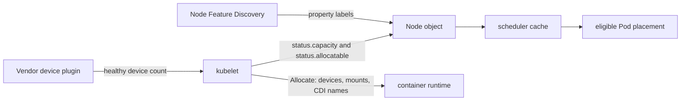

## From Observation to Control



- One of Pod's specifications (`spec`) is a resource request. 
  - This value can influence scheduling decision, 
- On the other hands, resource limits can become a Linux kernel enforcement action.

Three separate decisions are involved in this process

| Decision | Question | Component that answers it |
| --- | --- | --- |
| Placement | Which node can take this Pod? | kube-scheduler, using requests, labels, taints, and extended resources |
| Admission | Is this namespace allowed to ask? | API server, using ResourceQuota and LimitRange |
| Enforcement | What happens if the container uses more? | Linux, programmed by the kubelet through the CRI |





Kubernetes inherited Borg's resource vector: 

- CPU and memory are requested in fine units.
- Pod may also request devices that only some machines have.





- **1 CPU** is one Kubernetes CPU unit, corresponding to one hyperthread of allocatable capacity on the node.
- The API writes fractional CPU in **millicores**: `500m` is half a core, `1000m` is one core.
- CPU is **compressible**:
  - The kernel can slow a container down by giving it fewer slices of time even thought the process keeps running.
- Borg measured CPU in milli-cores for the same reason. 
  - This is an abstraction over heterogeneous hardware.





- Memory is measured in bytes.
- SI suffixes (`k`, `M`, `G`) are powers of 10.
- Binary suffixes (`Ki`, `Mi`, `Gi`) are powers of 2.
  - `256Mi` is $256 x 2^20$ bytes. 
  - `1Gi` is $2^30$ bytes.
- Memory is **incompressible**. 
  - Reclaiming memory means discarding the contents of pages. 
  - Once a hard limit is reached, the kernel terminates a process in that cgroup (`OOMKilled`, as shown in the previous lecture)





| Resource | Example | What is being counted |
| --- | --- | --- |
| Ephemeral storage | `ephemeral-storage: "1Gi"` | Writable layer and logs on the node's local disk |
| Huge pages | `hugepages-2Mi: 128Mi` | Pre-reserved large pages |
| Extended resource | `nvidia.com/gpu: 1` | A device the node has advertised |

- CPU and memory limits become cgroup controllers. 
- Ephemeral-storage limits are enforced by the kubelet, which watches disk usage and evicts the Pod. 
- Extended resources are enforced by exclusive allocation done by the device plugin. 




## Requests, Limits, and Slack



Every container can declare a **request** and a **limit** for each resource it uses.

```yaml
resources:
  requests:
    cpu: "250m"
    memory: "256Mi"
  limits:
    cpu: "500m"
    memory: "512Mi"
```

- The **request** is what the scheduler subtracts from the node's allocatable capacity. It is also the container's relative weight when the CPU is contended.
- The **limit** is the hard ceiling the runtime installs. 
  - For CPU, exceeding it causes throttling. 
  - For memory, exceeding it causes an OOM kill.
- The gap between usage and the limit is **slack**. 
  - Slack is capacity the container is allowed to burst into, and capacity the cluster cannot safely give to someone else unless that someone can be evicted.
- *This is different from typical supercomputing schedulers*:
  - Exceeding requests = allocation killed


- Google Borg originally used the limit both to admit the job against quota and to test whether a machine had available resources. 
  - This led to users asked for more than they used, because exceeding RAM killed the task and exceeding CPU throttled it. 
- Borg then estimated a lower **reservation** from observed usage and packed other work into the difference. 
- Kubernetes makes that `difference` explicit: 
  - the request is the reservation, serviced by the scheduler, and 
  - the limit is the ceiling, enforced by the Linux kernel.







[Google's Autopilot paper (EuroSys 2020)](https://research.google/pubs/autopilot-workload-autoscaling-at-google-scale/) measures slack as the difference between the limit and actual usage. Across their comparison, manually chosen limits left about 46% slack. Autopilot, which sets CPU and memory limits from historical usage, brought slack to about 23%, and reduced the number of jobs severely affected by OOM kills by about 10×. At the time of the paper, jobs under Autopilot accounted for over 48% of fleet-wide resource usage.

- In practice, an OOM or a throttle is visible to the job's owner, while wasted slack stays quiet
  - Therefore, users will always pad their limits. 
  - Closing the gap safely takes a history of usage. 
- In Kubernetes the same split appears as two controllers: 
  - the Horizontal Pod Autoscaler changes replica count from current metrics, and 
  - the Vertical Pod Autoscaler recommends requests from history. 





- Requests and limits determine where a Pod can run, how it fails, and what the cluster appears to cost. 
- In [OpenAI's account of scaling Kubernetes to 7,500 nodes](https://openai.com/index/scaling-kubernetes-to-7500-nodes/), low-priority "balloon" Deployments occupied otherwise idle capacity and remained immediately evictable when real work arrived. That is slack, held by a workload the scheduler is allowed to throw away. 
- Borg did the same thing with batch tasks that were willing to use reclaimed memory and be sacrificed when a latency-sensitive task needed it back.
- Evidence for a capacity decision includes:
  - request, limit, and usage percentiles over a real time range;
  - throttling, OOM kills, and eviction history;
  - pending Pods, and which resource or hardware constraint left them pending;
  - the burst the service actually needs, and how quickly it must scale;
  - the reliability and cost of allocating too much or too little.



## Namespaces, Quotas, and Defaults



- A namespace is the scope in which a team shares a cluster (API boundary). 

Kubernetes creates a few namespaces for its own infrastructure:

| Namespace | Role |
| --- | --- |
| `default` | Where objects go when the client names no namespace |
| `kube-system` | Control-plane add-ons, including the RKE2 Metrics Server from lecture 9 |
| `kube-public` | Objects intended to be readable cluster-wide |
| `kube-node-lease` | Node heartbeats |





- A ResourceQuota caps aggregate consumption in one namespace: 
  - total CPU and memory requests 
  - total CPU and memory limits, 
  - number of Pods, and 
  - counts of other object types. 
- It can also cap extended resources.

```yaml
apiVersion: v1
kind: ResourceQuota
metadata:
  name: dev-quota
  namespace: dev
spec:
  hard:
    requests.cpu: "2"
    requests.memory: 1Gi
    limits.cpu: "4"
    limits.memory: 1Gi
    pods: "4"
    requests.nvidia.com/gpu: "1"
```

- The API server checks the quota before it stores the object. 
  - A Deployment that would push the namespace over its request total is rejected





- A container that declares neither requests nor limits is `BestEffort`. 
  - It is scheduled as if it needed nothing, and it is the first to be evicted when the node is under pressure. 
- A `LimitRange` gives a namespace a default request, a default limit, a minimum, and a maximum, applied by admission to containers that omit the fields.

```yaml
apiVersion: v1
kind: LimitRange
metadata:
  name: default-limits
  namespace: dev
spec:
  limits:
  - type: Container
    defaultRequest:
      cpu: 200m
      memory: 256Mi
    default:
      cpu: 500m
      memory: 512Mi
    max:
      cpu: "2"
      memory: 2Gi
    maxLimitRequestRatio:
      cpu: "4"
```

`maxLimitRequestRatio` caps slack directly: 
  - the limit may be at most four times the request. 
- This impacts Admission of new jobs. 
- Actual enforcement still waits until a kubelet programs a cgroup.




## Hardware Labels and Specialized Nodes



- Aim to support a variety of data center (`cells`) with heterogeneous hardware configurations. 
- Users specify `job constraints` that can be used by the scheduler to match against machines' attributes and resource availability. 







How do Kubernetes describe hardware attributes and resource availability?



When matching workloads to infrastructure, Kubernetes evaluates a spectrum of hardware signals. These signals are not interchangeable, and they are split across different parts of the node API depending on how they are measured and consumed:

- Core Resources (Node Status): 
  - Ordinary CPU, memory, ephemeral-storage, and huge-page requests live natively in node.status. 
  - The scheduler uses these metrics to filter nodes based on remaining allocatable capacity.
• Dynamic Resource Allocation (DRA): 
  - For complex, modern hardware accelerators, 
  - Provides `DeviceClass`, `ResourceClaim`, and `ResourceSlice APIs`. Stable since Kubernetes v1.35, 
  DRA supports advanced Common Expression Language (CEL) attribute filtering, device sharing, and per-workload configurations. 
  - Replaces or complements legacy device plugins on supported drivers.

To target specific machines, specialized nodes break the scheduling problem down into three smaller 
questions using a combination of labels, extended resources, and taints:

| Signal | Question it answers | Producer | Workload-side API |
| --- | --- | --- | --- |
| Node label | What property or location does this node have? | kubelet, cloud controller, Node Feature Discovery, or an administrator | `nodeSelector` or node affinity |
| Extended resource | How many indivisible units are healthy and allocatable? | Usually a device plugin through the kubelet | Container `resources.requests` and `resources.limits` |
| Node taint | Which Pods should be repelled from this node? | RKE2 registration or an administrator | Pod toleration |

A specialized node commonly uses all three:

- Labels by themselves don't provide specifics on the devices (need Extended resource)
- Device requests cannot support the exclusion of non-device job requests (need Taint)

While the above form the baseline hardware signals, the complete scheduling API also factors in operational constraints:

- Pod affinity and anti-affinity place a Pod relative to other labeled Pods;
- topology-spread constraints distribute replicas across node-label domains
  such as zones or hostnames;
- priority and preemption decide which lower-priority workload may be displaced
  when eligible nodes are full;
- `nodeName` bypasses normal scheduler placement and should be reserved for
  exceptional administrative use;
- scheduler profiles and plugins can add organization-specific filtering and
  scoring;

The next three details blocks follow the data flow:

1. **Labels the node already carries** explains properties published during
   normal node registration.
2. **Labels that describe discovered hardware** explains add-ons that discover
   features and advertise consumable devices.
3. **How workload YAML consumes node signals** shows how a Pod combines
   selection, toleration, and reservation.





The kubelet and, on a cloud provider, the cloud controller, publish stable labels:

| Label | Meaning |
| --- | --- |
| `kubernetes.io/arch` | `amd64`, `arm64`, or another architecture. The container image has to match. |
| `kubernetes.io/os` | `linux` on the course cluster |
| `kubernetes.io/hostname` | The node name |
| `node.kubernetes.io/instance-type` | The machine shape, when a cloud integration sets it (`m5.xlarge`, `n2-standard-8`) |
| `topology.kubernetes.io/zone` | Failure domain inside a region |
| `topology.kubernetes.io/region` | Region |
| `node-role.kubernetes.io/control-plane` | This node runs the control plane |

`arch` and `os` are hardware and platform labels with a hard consequence. An `arm64` image scheduled onto an `amd64` node does not fail in the scheduler if the Pod forgot the constraint; it fails when the runtime tries to execute a binary the CPU cannot run. Putting the constraint in the Pod spec moves that failure forward, to placement.

On the FABRIC clusters used in this course there is no EC2-style cloud controller writing `instance-type`. The kubelet still advertises CPU, memory, pods, and ephemeral storage from the Linux host, which is why a 4-vCPU VM reports `capacity.cpu` of 4. Anything more specific — a GPU, a SmartNIC, a particular CPU feature — appears only after something on the node publishes it.

Inspect the source-of-truth Node objects rather than assuming that every
cluster has the same labels:

```bash
kubectl get nodes --show-labels
kubectl get node <node-name> -o jsonpath='{.metadata.labels}'
kubectl describe node <node-name>
```

Labels are metadata, not capacity. An administrator can label a node
`course.example.com/accelerator=nvidia` even when no GPU exists, so labels
should describe facts maintained by trusted automation. For isolation
decisions, use a DNS-qualified key and, when appropriate, a prefix protected
by the `NodeRestriction` admission plugin so a compromised kubelet cannot
award itself a sensitive placement label.





[Node Feature Discovery](https://github.com/kubernetes-sigs/node-feature-discovery) inspects the host and publishes labels. Illustrative keys:

| Label | What was detected |
| --- | --- |
| `feature.node.kubernetes.io/cpu-cpuid.AVX512F=true` | A CPU feature bit |
| `feature.node.kubernetes.io/cpu-model.vendor_id=GenuineIntel` | CPU vendor string |
| `feature.node.kubernetes.io/pci-10de.present=true` | A PCI device from vendor `10de` (NVIDIA) |

These labels are properties. `pci-10de.present=true` says a GPU is attached. The free count lives in an extended resource, usually `nvidia.com/gpu`, registered by a device plugin. A Pod that selects the node only by label can land there while leaving the device unreserved.

A device plugin is a daemon on the node. It registers with the kubelet, lists healthy devices, and, when a Pod is about to start, returns the device nodes to pass into the container. The kubelet adds the count to `status.capacity` and `status.allocatable`. From then on the scheduler treats `nvidia.com/gpu: 1` like a request for one indivisible unit of capacity.

The producer chain is therefore:



Node Feature Discovery does not allocate the GPU. The device plugin does not
decide which user is entitled to it. The scheduler reserves the advertised
integer, and the kubelet asks the plugin to make the selected device available
to the container.

For current drivers, DRA is a richer alternative. A driver publishes
`ResourceSlice` objects containing device attributes and node accessibility;
an administrator defines a `DeviceClass`; and a workload references a
`ResourceClaim` or `ResourceClaimTemplate`. The scheduler chooses a matching
device and a node together. Check the RKE2 Kubernetes version and vendor
driver documentation before using DRA; older course clusters may expose the
same device only through `nvidia.com/gpu`.

The usual policy for scarce hardware has four layers:

1. a discovery label describes the model, feature, or location;
2. an extended-resource request or DRA claim reserves a concrete device;
3. a taint such as `course.example.com/accelerator=nvidia:NoSchedule` keeps
   ordinary Pods off the specialized node;
4. a `ResourceQuota` limits how many devices one namespace may consume.

The first three affect placement or allocation. Quota is different: the API
server rejects an excessive request before the scheduler sees it.

For physical devices, install the vendor's device plugin or DRA driver as a
cluster add-on, normally a DaemonSet. Manually adding a GPU label is not a
substitute. Kubernetes also permits an administrator to PATCH a custom
extended resource into the Node `status` subresource, but that only creates a
schedulable counter; it does not arrange device nodes, drivers, mounts, or
container access. Device plugins are the correct mechanism for real GPUs,
FPGAs, SmartNICs, and similar hardware.





A `nodeSelector` is a hard constraint, the Borg hard attribute:

```yaml
spec:
  nodeSelector:
    kubernetes.io/arch: amd64
    feature.node.kubernetes.io/pci-10de.present: "true"
```

Node affinity expresses the hard case and the soft case separately. `requiredDuringSchedulingIgnoredDuringExecution` filters nodes. `preferredDuringSchedulingIgnoredDuringExecution` adds score, and the scheduler may ignore it when no preferred node has room. Borg called the second kind a soft constraint.

```yaml
affinity:
  nodeAffinity:
    requiredDuringSchedulingIgnoredDuringExecution:
      nodeSelectorTerms:
      - matchExpressions:
        - key: kubernetes.io/arch
          operator: In
          values: ["amd64"]
    preferredDuringSchedulingIgnoredDuringExecution:
    - weight: 50
      preference:
        matchExpressions:
        - key: topology.kubernetes.io/zone
          operator: In
          values: ["zone-a"]
```

The long field names record a real limit. Affinity is evaluated when the Pod is scheduled. If a label later changes, Kubernetes does not automatically move the running Pod. Placement is a decision about the moment the scheduler binds the Pod to a node.

A complete workload for a tainted GPU node combines the three core signals:

```yaml
apiVersion: apps/v1
kind: Deployment
metadata:
  name: gpu-demo
spec:
  replicas: 1
  selector:
    matchLabels:
      app: gpu-demo
  template:
    metadata:
      labels:
        app: gpu-demo
    spec:
      # Attract the Pod only to nodes with this trusted property.
      nodeSelector:
        course.example.com/accelerator: nvidia

      # Permit this Pod onto nodes protected by the matching taint.
      tolerations:
        - key: course.example.com/accelerator
          operator: Equal
          value: nvidia
          effect: NoSchedule

      containers:
        - name: shell
          image: ubuntu:24.04
          command: ["sleep", "infinity"]
          resources:
            requests:
              cpu: "500m"
              memory: 512Mi
              nvidia.com/gpu: "1"
            limits:
              cpu: "1"
              memory: 1Gi
              nvidia.com/gpu: "1"
```

Read each field independently:

- `nodeSelector` filters by a property but reserves nothing.
- The toleration permits placement but does not require the tainted node.
- `nvidia.com/gpu: 1` reserves one advertised device and causes the kubelet to
  call its device plugin. Extended resources are integer-valued, cannot be
  overcommitted, and have equal request and limit.
- CPU and memory still participate in ordinary capacity filtering and runtime
  enforcement.

Topology-spread constraints and Pod anti-affinity solve a different problem:
they distribute replicas relative to other Pods across labeled topology
domains. They do not discover or allocate hardware. For example, a Deployment
can spread replicas across hostnames after all hardware and resource filters
have already selected the eligible nodes:

```yaml
topologySpreadConstraints:
  - maxSkew: 1
    topologyKey: kubernetes.io/hostname
    whenUnsatisfiable: DoNotSchedule
    labelSelector:
      matchLabels:
        app: gpu-demo
```





RKE2 configuration is YAML, but it is not a Kubernetes manifest. It is a
host-local file read by the `rke2-agent` or `rke2-server` systemd service.
RKE2 documents these as
[`node-label` and `node-taint` registration options](https://docs.rke2.io/advanced#node-labels-and-taints).
Place node-specific configuration in `/etc/rancher/rke2/config.yaml` before
the node first joins the cluster.

On a GPU worker, merge the following fields into the existing agent
configuration:

```yaml
# /etc/rancher/rke2/config.yaml
server: https://CONTROL-PLANE:9345
token: "REPLACE_WITH_CLUSTER_JOIN_TOKEN"

node-label:
  - "course.example.com/accelerator=nvidia"
  - "course.example.com/hardware-class=gpu"

node-taint:
  - "course.example.com/accelerator=nvidia:NoSchedule"
```

Then start the worker:

```bash
sudo systemctl enable --now rke2-agent
```

A schedulable RKE2 server uses the same `node-label` and `node-taint` keys in
its local config, but its service is `rke2-server`.

The host must already have the required kernel and vendor drivers. After the
Kubernetes API is available, the cluster administrator installs Node Feature
Discovery and the vendor device plugin or DRA driver as cluster add-ons. Those
add-ons publish discovered labels and allocatable devices; RKE2's
`node-label` setting should contain only administrator-owned, stable policy
labels.

Verify all four layers:

```bash
kubectl get nodes \
  -L course.example.com/accelerator,course.example.com/hardware-class
kubectl describe node <gpu-node>
kubectl get pods -A -o wide
```

RKE2's `node-label` and `node-taint` options are registration-time settings.
Changing the file and restarting RKE2 does not update an already registered
Node. Use the Kubernetes API for a live Node, and keep the RKE2 file aligned so
the intended metadata returns if the Node is deleted and registered again.





For a Node that has already joined, the direct commands are:

```bash
kubectl label node <gpu-node> \
  course.example.com/accelerator=nvidia \
  course.example.com/hardware-class=gpu \
  --overwrite

kubectl taint node <gpu-node> \
  course.example.com/accelerator=nvidia:NoSchedule
```

`NoSchedule` blocks new non-tolerating Pods but does not evict Pods already
running there. If the node is being repurposed, cordon and drain it first:

```bash
kubectl cordon <gpu-node>
kubectl drain <gpu-node> --ignore-daemonsets --delete-emptydir-data
# Apply labels, taints, host drivers, and device add-ons.
kubectl uncordon <gpu-node>
```

Automation can apply administrator-owned metadata with a narrow Node
manifest. Create `gpu-node-metadata.yaml`:

```yaml
apiVersion: v1
kind: Node
metadata:
  name: REPLACE_WITH_GPU_NODE_NAME
  labels:
    course.example.com/accelerator: nvidia
    course.example.com/hardware-class: gpu
spec:
  taints:
    - key: course.example.com/accelerator
      value: nvidia
      effect: NoSchedule
```

Apply it with a dedicated server-side field manager:

```bash
kubectl apply --server-side \
  --field-manager=specialized-node-policy \
  -f gpu-node-metadata.yaml
```

Do not export a complete Node object, edit it, and apply it back. `status`,
addresses, leases, conditions, capacity, and many system labels are maintained
by the kubelet or controllers. Keep the manifest limited to custom labels and
taints that the administrator owns.

An extended resource is not configured in this Node manifest. It belongs in
the Node `status` subresource and should normally be published by a device
plugin or DRA driver. Likewise, the workload's selector, toleration, and
resource request belong in the Deployment or Pod manifest, not in the RKE2
host configuration.



Allocatable capacity is the number the scheduler uses. It is capacity minus what the node reserves for the operating system and for Kubernetes itself (kubelet, containerd, the CNI agent). Lecture 9 distinguished `capacity` from `allocatable`. A node that looks half idle in `kubectl top` can still refuse a Pod, because free space for scheduling is allocatable capacity minus requests already admitted. A recent usage sample describes the past window. The scheduler accounts for reservations.

## How Enforcement Reaches Linux

RKE2 enforces a Pod limit by handing a number to Linux, which already implements the resource controller. Kubernetes contributes the translation from a Pod spec into that number. RKE2 contributes the runtime wired to the translation.



1. **The Pod spec** is stored in etcd. At this point it is data. Nothing on any node has been limited.
2. **Admission** may rewrite defaults or reject the object for quota. This is an API decision.
3. **The scheduler** filters nodes by requests, extended resources, required affinity, and tolerations, then binds the Pod. It accounts for the request. Process creation happens later, in the kubelet.
4. **The kubelet** on the bound node creates a Pod sandbox and then each container. For every container it fills a CRI `LinuxContainerResources` message: CPU shares from the request, CPU quota from the limit, memory limit, and an OOM score adjustment from the QoS class.
5. **containerd**, speaking the CRI, prepares the container and invokes an OCI runtime. RKE2's default runtime is runc.
6. **runc** writes the cgroup and enters the namespaces. After it returns, the kernel is the enforcer.

The CRI is a gRPC API with two services, one for runtime lifecycle and one for images. Kubernetes 1.5 introduced it so the kubelet would speak one runtime contract. Dockershim, the in-process adapter that spoke to Docker, was removed in Kubernetes 1.24. The Pod fields for requests and limits stayed the same. The program on the far side of the socket changed. Lecture 3's choice of containerd leaves this resource model intact.





On a course node, RKE2 starts containerd and the kubelet and points the kubelet at containerd's socket:

```text
/run/k3s/containerd/containerd.sock
```

Lecture 9 used that socket with `crictl`. The `k3s` path is historical; RKE2 inherited the layout. The socket is the CRI endpoint, in the `k8s.io` containerd namespace.

RKE2 runs under systemd and configures kubelet and runc with the **systemd cgroup driver**, so both use the hierarchy systemd owns. 

containerd transports the CRI request and supervises the shim. runc applies the limit. SELinux, on by default in RKE2, is a mandatory-access-control boundary beside this path. It confines what a process may open. CPU time is assigned by the cgroup controllers.





The kubelet translates CPU with a 100 ms quota period.

| Pod field | Effect under contention or at the ceiling |
| --- | --- |
| CPU request of `250m` | `cpu.shares` of 256 on cgroup v1, converted by runc to `cpu.weight` on cgroup v2. Shares matter when the CPU is busy. They are relative weights. |
| CPU limit of `500m` | A CFS quota of 50 ms of run time in each 100 ms period (`cpu.max` on cgroup v2). The kernel throttles the cgroup for the rest of the period. |
| CPU request of `1000m` | 1024 shares, the historical weight of one core. |
| Memory request | Reserved in the scheduler, and reflected in the container's OOM score. The hard memory cap is the limit. |
| Memory limit | `memory.max`. An allocation past it is killed inside the cgroup. |

The share formula is `millicores × 1024 / 1000`, with a floor of 2. The quota formula is `millicores × 100000 µs / 1000`. A limit of one full CPU is one whole period. A limit of two CPUs is two periods' worth of run time in each period, which is how a multi-threaded container is allowed to occupy more than one core.

Guaranteed Pods receive `oom_score_adj` of `-997`. BestEffort Pods receive `1000`. Burstable Pods fall between, scaled by how much memory they requested relative to the node. When the node itself is out of memory, the kernel prefers to kill the higher score.



This arrangement is possible for four reasons that are easy to conflate.

- **Linux already accounts for groups of processes.** cgroups, developed with substantial work from Google engineers and merged into the kernel, limit CPU, memory, pids, and devices for a set of processes. cgroup v2, stable in Kubernetes since 1.25, puts those controllers in one hierarchy. Namespaces give the container its own view of pids, mounts, and the network. The kernel feature is older than Kubernetes.
- **The OCI runtime spec turns a config file into those kernel calls.** runc is a small program whose job is to apply that spec to interfaces the kernel already exports.
- **The CRI keeps the kubelet from depending on one runtime.** The kubelet says "this container gets this much CPU and memory." containerd, CRI-O, or a hypervisor runtime can implement the sentence. RKE2 chose containerd.
- **The scheduler trusts the node's advertisement.** The kubelet computes capacity from the host, subtracts reservations, adds extended resources reported by device plugins, and posts labels. The scheduler places Pods against that report. It never opens a cgroup file.

Borg's Borglet did the last two steps inside one agent: it polled the master and wrote cgroup settings itself. Kubernetes split the agent (kubelet) from the runtime (CRI) so a distribution could replace the runtime. RKE2 is that kind of choice. The Pod spec students write would mean the same thing on a CRI-O node. The socket, the binary, and the cgroup driver would differ.

Stopping the kubelet stops new Pods from starting on that node. cgroup limits on containers that are already running remain, because the kernel holds them. That is also why lecture 9 could read `crictl stats` and `systemd-cgtop` as a second view of the same counters Metrics Server exports. Observation and enforcement are two clients of one kernel accounting system.



CPU quota and a memory cap leave the last-level cache, memory bandwidth, and the CPU's internal buffers shared. Borg's 2015 paper records the consequence: after every task ran in a cgroup, interference in memory bandwidth and the L3 cache still occurred. Two Pods can each stay under their CPU limit while one of them runs slower because the other is thrashing a shared cache.

Google's CPI² system (EuroSys 2013) treated a rise in cycles per instruction, read from hardware performance counters, as evidence of that interference, identified a likely antagonist, and throttled it. Heracles (ISCA 2015), discussed below, added cache partitioning and bandwidth controls beyond the ordinary cgroup CPU controller. Those results bound the model this course runs. RKE2 plus containerd plus cgroups gives each container a CPU share, a CPU quota, and a memory cap. Cache and memory bandwidth remain shared.



## Quality of Service and Contention

Kubernetes derives a QoS class from the relationship between requests and limits. The class selects a cgroup parent and an OOM score. It is the cluster's version of Borg's split between latency-sensitive and batch work.

| QoS class | Condition | Under node pressure |
| --- | --- | --- |
| Guaranteed | Every container sets requests equal to limits for CPU and memory | Highest protection. `oom_score_adj` −997. Evicted last. |
| Burstable | Some request is set, and some limit is higher than its request | Weight comes from the request. Burst is allowed up to the limit, then throttle or OOM. Evicted before Guaranteed Pods once it exceeds its request. |
| BestEffort | No container sets a request or a limit | Uses only slack. `oom_score_adj` 1000. Evicted first. |

Three different components can be the one that stops a container:

| Actor | Trigger | What the container experiences |
| --- | --- | --- |
| Linux memory controller | Usage passed the cgroup memory limit | `OOMKilled`. The Pod may restart. The node can be otherwise healthy. |
| kubelet eviction | The node crossed a pressure threshold, such as low available memory | The kubelet deletes Pods in QoS and priority order to protect the node and the system daemons. |
| Scheduler preemption | A higher-priority Pod needs a node that is full of lower-priority requests | A lower-priority Pod is terminated so the new one can bind. |

Borg organized priority into bands — monitoring, production, batch, best-effort — and refused to let production tasks preempt each other, specifically to avoid preemption cascades. Kubernetes expresses priority with a PriorityClass. Pods in the same priority do not preempt one another. A higher class may preempt a lower one. QoS and priority are different axes: QoS comes from the resource fields, priority is an explicit ranking. The OpenAI balloon Deployments sit at low priority so they lose the preemption and eviction decisions, while still holding the idle machines.

Guaranteed is the right class when the service needs predictable latency and the operator is willing to pay for the ceiling at all times, because the request equals the limit and slack inside that Pod is zero. Burstable is the right class when the service is usually small and sometimes spikes. BestEffort is what remains when the spec says nothing, which is why a LimitRange exists.

## What Google and Amazon Implemented

The mechanisms above are a specific answer to multi-tenancy: share a kernel, expose machine differences to the scheduler, and let users ask for fine-grained resource vectors. Google's papers are the history of that answer. Amazon's Firecracker paper is the argument for a different answer when the neighbor is an untrusted customer.

| Design | Where it runs | How hardware shows up | How isolation is achieved |
| --- | --- | --- | --- |
| Borg, then Kubernetes | A trusted fleet, many jobs per machine | Machine attributes, or node labels plus extended resources. The scheduler sees the differences. | Shared kernel. cgroups for performance. Namespaces, and in RKE2 SELinux, for confinement. |
| EC2-style instance types | A public cloud selling a virtual machine | The customer buys a fixed shape. The provider may hide host differences. | A VM boundary per instance. Fixed buckets of CPU and memory. |
| Lambda and Fargate on Firecracker | Public serverless, dense multi-tenant hosts | The host can hide CPUID bits so a mixed fleet looks uniform to the guest. | One KVM microVM per workload, with its own kernel. The host still uses cgroups and the Linux scheduler, plus rate limiters on disk and network. |



[Verma, Pedrosa, Korupolu, Oppenheimer, Tune, and Wilkes, "Large-scale cluster management at Google with Borg," EuroSys 2015.](https://research.google/pubs/large-scale-cluster-management-at-google-with-borg/)

The paper is the source for several rules this lecture uses.

- Cells mix machine sizes, processor types, and special devices. Jobs carry hard and soft attribute constraints. Kubernetes labels, required affinity, and preferred affinity are that mechanism with a different API.
- Users request CPU in milli-cores and memory in bytes, and the distribution of requests has no small set of sweet spots. Rounding requests up to the next power of two, the way a catalog of fixed VM sizes does, would have needed about 30–50% more resources in the median case. Fine-grained requests exist because fixed buckets waste machines.
- Every task runs in a Linux cgroup. The Borglet sets the container. Compressible resources (CPU cycles, disk bandwidth) are throttled. Non-compressible resources (memory, disk space) are reclaimed by killing tasks, lowest priority first. The request/limit behavior in Kubernetes is this distinction, made into API fields.
- Early Borglet enforcement checked usage after the fact and killed or reniced offenders. Neighbors still interfered, and users inflated their requests to keep neighbors off the machine. Putting the kernel in the loop, by writing cgroup settings, is what made sharing acceptable. Kubernetes starts from that later design.
- Security isolation for Google's own jobs was a chroot and a cgroup. Untrusted code, in App Engine and Compute Engine, ran in KVM virtual machines that were themselves Borg tasks. The paper already separates "shared kernel for the fleet" from "a VM for code you do not trust."

Lecture 2 covered the master, the cell, and the 2020 trace study. The resource lesson to add is the one [Tirmazi et al., "Borg: the Next Generation," EuroSys 2020](https://dl.acm.org/doi/10.1145/3342195.3387517) still had to document: allocation and usage diverge, and sizing remains a first-order efficiency problem.





[Zhang, Tune, Hagmann, Jnagal, Gokhale, and Wilkes, "CPI²: CPU performance isolation for shared compute clusters," EuroSys 2013.](https://dl.acm.org/doi/10.1145/2465351.2465388)

Linux, the paper argues, has few defenses against interference in caches and memory buses. CPI² watches cycles per instruction with hardware counters, learns a normal CPI for the job, and throttles the task most likely to be the cause. Google had deployed it across the shared fleet by the time of the paper. The important design point is that the signal comes from performance counters, and the actuator is still a cgroup throttle. Detection left the kernel; enforcement came back to the same controller Kubernetes uses.

[Lo, Cheng, Govindaraju, Ranganathan, and Kozyrakis, "Heracles: Improving Resource Efficiency at Scale," ISCA 2015.](https://dl.acm.org/doi/10.1145/2749469.2749475)

Heracles colocates best-effort work with a latency-critical service and manages four isolators: CPU cores through cpuset cgroups, last-level cache through Intel Cache Allocation Technology, DRAM bandwidth by watching performance counters and shrinking the best-effort core set, and the network. In the evaluated scenarios the machines reached about 90% utilization while the latency target held.

Heracles is the argument that a CPU quota and a memory limit are the first layer of a deeper problem. A latency-sensitive Pod and a batch Pod on one RKE2 node are that same colocation, with the cgroup layer turned on. Cache partitioning and memory-bandwidth control remain node-level, hardware-specific mechanisms. In Kubernetes they appear, when they appear, as further device or topology features beside the `cpu` and `memory` fields.





[Rzadca, Findeisen, Swiderski, Zych, et al., "Autopilot: workload autoscaling at Google," EuroSys 2020.](https://dl.acm.org/doi/10.1145/3342195.3387524)

Autopilot sets the limit the API asks humans to set. Vertical scaling changes CPU and memory limits of a task. Horizontal scaling changes the number of tasks. Models trained on previous runs of the same job, plus heuristics, try to cut slack without driving OOM kills or CPU throttling. The paper is explicit that the standard Linux cgroup behavior — throttle CPU, kill on memory — is why operators pad limits, and why an automated recommender has to be conservative in a different direction for each resource.

This is the production form of the comparison lecture 9 set up: configuration against history. The paper also records the organizational problem. Recommendations had to be visible before teams opted in, some categories of jobs were migrated automatically, and custom recommenders had to be allowed. A correct model of slack does not, by itself, change what people write in a manifest.





[Agache, Brooker, Florescu, Iordache, Liguori, Neugebauer, Piwonka, and Popa, "Firecracker: Lightweight Virtualization for Serverless Applications," NSDI 2020.](https://www.usenix.org/conference/nsdi20/presentation/agache)

Firecracker is Amazon's case that the Borg/Kubernetes boundary is the wrong one for public multi-tenancy. Lambda and Fargate needed to run mutually untrusted customers on the same host, at high density, with fast startup. The paper states the tradeoff they refused: virtual machines with strong isolation and high overhead, or containers with less overhead and a shared kernel.

The design choices that matter for this lecture:

- Each workload is a KVM guest with its own kernel. A process in the guest does not make system calls to the host kernel. That is the security boundary cgroups do not provide. The paper notes that containers combine cgroups, namespaces, seccomp, and chroot, and that seccomp's value depends on how many system calls the guest is forbidden — a compatibility tradeoff.
- Firecracker still asks Linux to schedule CPU and memory on the host. One Firecracker process runs per microVM, the process is placed in a cgroup, and the host scheduler and memory manager handle contention. Rate limiters on the virtual disk and network device apply token buckets to IOPS and bandwidth. The compressible-resource idea survives; the mechanism for disk and network is a userspace limiter in the VMM, because those devices are emulated.
- The machine-config API sets the guest's memory and vCPU count, and can mask CPUID bits "to make a heterogeneous compute fleet appear homogeneous." Kubernetes publishes `kubernetes.io/arch` and CPU-feature labels so the scheduler can match them. Firecracker can hide the same facts so customers see one CPU. Publishing heterogeneity and concealing it are both policies about mixed hardware.
- Lambda's first isolation model put several functions from one customer in containers inside a VM, and kept customers in different VMs. Packing onto those fixed-size VMs wasted capacity. That is Borg's 2015 objection to fixed buckets, encountered from the other side. Per-function microVMs with soft allocation of CPU and memory were the replacement.
- The paper is explicit that Firecracker replaces QEMU in the stack. Orchestration, packaging, and placement stay with systems such as Kubernetes, Docker, or containerd, or with Amazon's own control plane. A microVM is a stronger sandbox for a Pod. The scheduler remains a control plane above it.

Kata Containers is the Kubernetes-shaped version of that last point: a RuntimeClass that runs a Pod inside a small VM, with the kubelet still speaking CRI and the scheduler still reading requests. Pod overhead is then part of the request, because the guest kernel consumes memory before the application does. The course cluster uses the shared-kernel path Borg used for its own jobs.



The practical boundary for this course follows the papers. Inside one organization's cluster, RKE2, containerd, and Linux cgroups are the mechanism that makes requests and limits real, and node labels plus extended resources are the mechanism that makes different hardware schedulable. That is the Google fleet design, opened into an API. A public cloud that runs hostile neighbors adds a VM boundary, as Borg did for App Engine and as Lambda does with Firecracker, and pays for a second kernel on every sandbox. cgroups remain in the picture either way. In the shared-kernel design they are the isolation. In the microVM design they isolate the VMs from each other on the host.

