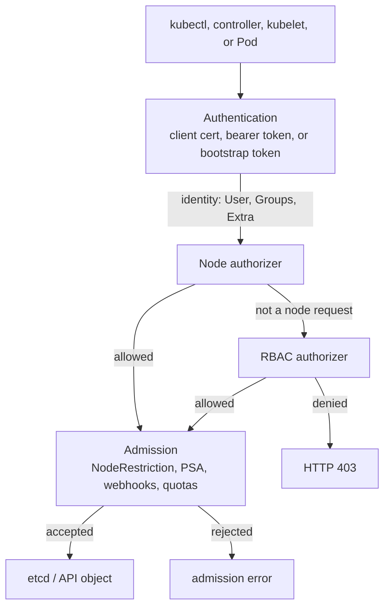

## Overview



The NIST RBAC family is usually presented in layers:

- **Core RBAC:** users, roles, permissions, sessions, and the assignment
  relations among them.
- **Hierarchical RBAC:** roles inherit permissions, and sometimes user
  membership, from other roles.
- **Constrained RBAC:** additional rules such as static and dynamic
  separation of duty.
- **Temporal constraints:** optional limits on when a role may be enabled
  or activated.

Kubernetes implements a practical subset of this model. RKE2 then ships a
specific default configuration: Node plus RBAC authorization, bootstrap
credentials, system identities for kubelets and controllers, and packaged
cluster components with their own ServiceAccounts.





- ACL (access control list)
    - a lower-level mechanism that names subjects authorized to access the
      object to which it refers;
    - specific permissions granted to each authorized subject.
- Roles
    - at a basic level, could be equivalent to the concept of groups
        - collection of users
        - users can have multiple roles (belong to multiple groups)
    - semantically different from groups
        - groups are implementation-specific and their characteristics can
          change;
        - roles are defined in terms of job functions with more stable
          permission sets.

Kubernetes still has both ideas. A `Role` or `ClusterRole` is a named
permission set. A `Group` in a certificate or identity provider is a
collection of users. Bindings connect the two.





- **Authentication** answers: who is this request from?
- **Authorization** answers: is that identity allowed to do this?
- Kubernetes also applies **admission control** after authorization. A
  request can be authenticated and authorized, then still rejected by
  Pod Security Admission, a validating webhook, or a quota.

On RKE2, a typical API request is authenticated with a client certificate
or a ServiceAccount token, authorized by the Node and RBAC authorizers,
and then admitted by plugins such as `NodeRestriction`.




## Core RBAC



- Consists of `users`, `roles`, and `permissions`, which are `operations`
  applied to `objects`.
- Permissions are associated with roles.
- Users are members of roles.
- A **session** (or activation) is the subset of a user's authorized roles
  that is currently in use.

In Kubernetes terms:

| NIST idea | Kubernetes object or concept |
| --- | --- |
| User | `User`, `Group`, or `ServiceAccount` |
| Role | `Role` or `ClusterRole` |
| Permission | a `PolicyRule`: `apiGroups`, `resources`, `verbs`, optional `resourceNames` |
| Object | an API resource such as `pods`, `secrets`, `nodes`, or a non-resource URL such as `/healthz` |
| User-role assignment | `RoleBinding` or `ClusterRoleBinding` |
| Session | a kubeconfig context, an API token, or an impersonated identity |





- Permissions are assigned to roles, not directly to every user.
- That simplifies understanding and management of permissions.
- Access requirements can be stated at the same level of abstraction as
  typical business processes:
    - role: teller, loan officer, doctor, nurse, cluster operator,
      application deployer, auditor;
    - operation: withdraw cash, write a prescription, `get pods`,
      `create deployments`, `list secrets`.

On a Kubernetes platform, the "enterprise" roles are often team names,
namespaces, and environments: `team-a-dev`, `team-a-prod-readonly`,
`platform-admin`.





- Permissions should reflect organizational policy, not whatever a YAML
  file happened to include.
- Core RBAC itself does not require mutually exclusive roles. Mutual
  exclusion, cardinality, and prerequisites belong to **constrained RBAC**.
- Kubernetes permissions are **additive**. There is no deny rule inside a
  `Role`. If any bound rule allows the request, RBAC allows it.
- Wildcards are especially powerful. A rule of `resources: ["*"]` and
  `verbs: ["*"]` applies not only to objects that exist today, but also to
  API types added later, including CustomResourceDefinitions.





- Properties and mappings in RBAC can be divided into static and dynamic
  components.
- Static mappings: which users are authorized for which roles, and which
  permissions those roles hold.
- Dynamic components include role activation and subject access:
    - dynamic mapping of a request subject to a user;
    - dynamic mapping of that user to an active role set.

Kubernetes does not ask a human to "activate role X" at login in the NIST
sense. Activation is implicit:

- a kubeconfig context selects a user credential;
- a Pod mounts a ServiceAccount token;
- `kubectl impersonate` temporarily acts as another user, group, or
  ServiceAccount.

Certificate lifetime, token expiration, and impersonation policy are the
closest built-in substitutes for session control.





- Privileges are system-specific and permissions are mapped into those
  privileges.
- Users and roles can have common meaning across multiple systems.


- The relationship between roles and permissions depends on the scope on
  which RBAC is implemented.
    - RBAC implemented within an operating system: integration with
      users/groups/operations and resources of the computer system.
    - For distributed systems: RBAC needs to be implemented at the
      identity-provider or directory level to support SSO.
    - For Kubernetes: the API server is the enforcement point. Host Linux
      accounts, LDAP users, and GitHub identities matter only after they
      are mapped to Kubernetes subjects.

{% include figure.liquid path="assets/img/courses/csc478/csc603/09-core-rbac/global-local-mapping.png" max-width="50%" zoomable=true %}

- First step for enterprise-level RBAC:
    - Create and maintain direct associations between RBAC users and local
      identities.
    - Local resources are protected via those identities.
- Operations and resources are created as abstractions.

{% include figure.liquid path="assets/img/courses/csc478/csc603/09-core-rbac/system-level-mapping.png" max-width="50%" zoomable=true %}

On RKE2, the local privileged identity is often the server kubeconfig at
`/etc/rancher/rke2/rke2.yaml`. That file is an administrative credential,
not a team role. Production platforms then map people through Rancher,
OIDC, or another identity provider onto Kubernetes `User` and `Group`
names.




## Hierarchical RBAC



- Permissions assigned to a role may contain, or be contained by, other
  roles in a hierarchy.
- "A inherits B" means all of B's permissions are available to A.
- Hierarchies add planning cost, but they can improve administrative
  productivity when many roles share a common permission set.

Kubernetes does not implement a general role-inheritance graph the way
NIST Hierarchical RBAC does. Instead it offers three practical substitutes:

- bind a shared `ClusterRole` into many namespaces with `RoleBinding`;
- use the built-in aggregated roles `admin`, `edit`, and `view`;
- add more rules to those user-facing roles with ClusterRole aggregation
  labels.





- Motivation: individual roles have overlapping functions.
- With role hierarchy, collections of permissions can be defined using
  multiple subordinate roles.
- Example:
    - Physician inherits from Resident
    - Cardiologist inherits from Physician
    - Oncologist inherits from Physician
    - Accounts receivable clerk does not inherit from, and is not inherited
      by, any of the above roles.

{% include figure.liquid path="assets/img/courses/csc478/csc603/09-core-rbac/example-hierarchy.png" max-width="50%" zoomable=true %}

A Kubernetes analogue is a namespace permission stack:

- `view` can list most objects but cannot read Secrets;
- `edit` can change workload objects and can read Secrets;
- `admin` can also manage Roles and RoleBindings inside the namespace;
- `cluster-admin` can do anything in any namespace.




- Direct privilege inheritance
    - Closed management systems where there is only a single class of
      resources and operations.
- Permission and user membership inheritance
    - A role represents both collections of permissions and users.
    - The top of the graph represents more powerful roles.
    - Greater opportunities exist for redundant authorization of
      permissions to a user.
{% include figure.liquid path="assets/img/courses/csc478/csc603/09-core-rbac/privilege-graph.png" max-width="50%" zoomable=true %}

- User containment and indirect privilege inheritance
    - Used in distributed RBAC implementations.
    - Permissions are assigned to groups and groups are mapped to roles.
    - Users belong to groups.
    - Examples: campus identity, GitHub teams, or an OIDC group claim
      mapped onto a Kubernetes `Group` subject.





- Role hierarchies can also support
    - line of authority
    - functional delineation
    - geographic or environment responsibilities (`dev`, `stage`, `prod`)
- Connector roles
    - not typically assigned to users
    - define a collection of permissions to be inherited by higher-order
      roles
    - Example:
        - Physician inherits from Resident
        - `Specialist` inherits from Physician
        - Cardiologist inherits from Specialist
        - Oncologist inherits from Specialist

{% include figure.liquid path="assets/img/courses/csc478/csc603/09-core-rbac/example-hierarchy-connector.png" max-width="50%" zoomable=true %}

ClusterRole aggregation is the Kubernetes connector-role mechanism. A
controller copies rules from labeled ClusterRoles into `admin`, `edit`,
or `view`. Direct edits to aggregated `rules` are overwritten.




- Typical enterprises are structured along organizational boundaries:
  departments, divisions, groups, and teams.
- OU: organizational units.

{% include figure.liquid path="assets/img/courses/csc478/csc603/09-core-rbac/example-ou.png" max-width="50%" zoomable=true %}

- OUs can describe
    - line of authority
    - resource ownership
    - areas of responsibility
- OUs do not
    - define complete sets of job positions or roles
    - prescribe privilege inheritance relations
- OUs do
    - assist in defining roles
    - represent collections of functions and users
    - define business processes and workflows

In Kubernetes, **namespaces** are the usual OU analogue for application
teams. They are not a complete security boundary by themselves: cluster
roles, node access, persistent volumes, and some admission policies still
cross namespaces. They are, however, the right place to bind most
day-to-day permissions.





- General hierarchies
    - support multiple inheritance of permissions and user membership
    - allow a role to have more than one immediate ascendant and more than
      one immediate descendant
    - example: student worker
- Limited role hierarchies impose restrictions, often a single immediate
  descendant
- Limited hierarchies remain common in commercial authorization products

- Stanford model:
    - object-oriented approach to distributing enterprise permissions
    - recognizes layers of abstraction: entitlements, tasks, functions,
      roles

{% include figure.liquid path="assets/img/courses/csc478/csc603/09-core-rbac/stanford-model-2.png" max-width="50%" zoomable=true %}
{% include figure.liquid path="assets/img/courses/csc478/csc603/09-core-rbac/stanford-model.png" max-width="50%" zoomable=true %}

RKE2 and Kubernetes sit closer to the Stanford layering than to a full
NIST inheritance graph: a job function (`platform-operator`) is composed
from tasks (`upgrade nodes`, `inspect workloads`) that become API
entitlements (`get nodes`, `list pods`).




## Separation of Duty and RBAC Constraints



- Separation of Duty (SoD) is a fundamental principle in security systems.
- Critical operations are divided among two or more people, so that no
  single individual can compromise security.




- Two broad categories: static and dynamic
    - Distinguished by the time at which the role constraints are applied.
    - Static SoD places constraints when users are authorized for roles.
    - Dynamic SoD constraints are applied when users are using the system.




- Enforces assignment of users to roles.
    - If a user is assigned to one role, they cannot be a member of another
      conflicting role.
    - In the presence of a hierarchy, inherited roles are also considered.
    - Example: a billing clerk role cannot also be an accounts-receivable
      clerk role.

{% include figure.liquid path="assets/img/courses/csc478/csc603/09-core-rbac/static-sod.png" max-width="50%" zoomable=true %}

Kubernetes does not enforce SSD automatically. Conflicting RoleBindings can
both exist. Static SoD is therefore an operational policy: code review,
admission policy, and periodic binding audits.




- Users may be authorized for conflicting roles, but limitations are
  imposed when the user is logged on:
    - timely revocation of trust;
    - remaining policy concerns if both roles can still be activated in
      sequence;
    - needs extensive system support.

Kubernetes sessions are request-scoped. Dynamic SoD is only as strong as
credential hygiene: short-lived tokens, no shared `cluster-admin`
kubeconfig, and no standing impersonation rights.





- Most RBAC systems available today support role hierarchies
    - Property 1: Two roles $R_i$ and $R_j$ can be mutually exclusive only
      if neither inherits the other, either directly or indirectly.
    - Property 2: If two roles are mutually exclusive, no third role may
      inherit both of them.
    - Property 3: If static SoD holds, then DSD is maintained. If a user
      is authorized for only one of two roles, that user cannot be active
      in both.
    - Property 4: If any two roles are mutually exclusive, there can be no
      `root` or `superuser` role that is routinely active.
- Mutual exclusion is used to enforce SoD policies.
    - Exclusion specified by sets
    - Exclusion specified by role-pairs
- Assigning roles to users
    - No single user should possess all privileges needed to accomplish a
      task controlled under SoD.
    - Given a set of roles and relationships, what is the minimal number
      of users required to keep SoD intact?

On an RKE2 cluster, `cluster-admin` and membership in `system:masters`
break Property 4. Those identities exist for break-glass administration.
They should not be the daily credential for application work.




- Incorporate time in access-control requirements
    - to limit resource usage in a workflow
    - to limit role availability and activation
- Taxonomy
    - temporal constraints on roles
    - temporal constraints on user-role assignments
    - temporal constraints on role-permission assignments
- Time-related concepts
    - periodicity
    - duration
- Examples
    - enable `doctor-on-call` only for specific people and hours
    - hire a contractor only between September and December
- Kubernetes approximations
    - client-certificate expiry
    - bound ServiceAccount token lifetime
    - time-limited Rancher or OIDC sessions
    - GitOps pull requests that add and later remove a binding



---

## Mapping RBAC onto Kubernetes



Kubernetes RBAC lives in the `rbac.authorization.k8s.io` API group and
uses four objects:

| Object | Scope | Purpose |
| --- | --- | --- |
| `Role` | namespaced | names a permission set inside one namespace |
| `ClusterRole` | cluster | names a permission set for cluster-scoped resources, or a reusable set of namespaced permissions |
| `RoleBinding` | namespaced | grants a Role, or a ClusterRole *limited to that namespace*, to subjects |
| `ClusterRoleBinding` | cluster | grants a ClusterRole across the cluster |

A RoleBinding may reference:

- a `Role` in the same namespace, or
- a `ClusterRole`, in which case the ClusterRole's namespaced permissions
  apply only inside the RoleBinding's namespace.

A ClusterRoleBinding is required to grant cluster-scoped power such as
listing Nodes, or to grant namespaced permissions in every namespace.




A binding names one or more subjects:

- **User:** an external person or automation identity. Kubernetes does not
  store a User object. The name comes from the authenticator, often a
  certificate Common Name or an OIDC `sub` / email claim.
- **Group:** also supplied by the authenticator. Certificate groups often
  come from the Organization (`O=`) field.
- **ServiceAccount:** the only first-class in-cluster identity object.
  Username form: `system:serviceaccount:<namespace>:<name>`.
  Group forms include `system:serviceaccounts` and
  `system:serviceaccounts:<namespace>`.




A permission rule is a tuple, not a Linux capability:

```yaml
apiVersion: rbac.authorization.k8s.io/v1
kind: Role
metadata:
  namespace: team-a
  name: pod-reader
rules:
  - apiGroups: [""]
    resources: ["pods"]
    verbs: ["get", "list", "watch"]
```

Important details:

- `apiGroups: [""]` means the core API group.
- Subresources are separate: `pods/log` and `pods/exec` are not implied by
  `pods`.
- Non-resource URLs such as `/healthz` can appear only on ClusterRoles.
- `bind`, `escalate`, and `impersonate` are high-risk verbs because they
  let a subject grant or assume permissions they do not already have.




| ClusterRole | Typical binding | Meaning |
| --- | --- | --- |
| `cluster-admin` | `system:masters` via ClusterRoleBinding | superuser: any verb on any resource |
| `admin` | RoleBinding in a namespace | namespace administrator, including Roles and RoleBindings, but not cluster objects |
| `edit` | RoleBinding in a namespace | mutate most namespace objects; can read Secrets |
| `view` | RoleBinding in a namespace | read most namespace objects; cannot read Secrets |

`edit` can escalate in practice: reading Secrets may reveal ServiceAccount
tokens, and creating Pods can run as another ServiceAccount in the same
namespace. `view` omits Secrets for that reason.





In production, engineers translate job functions and workload identities
into the smallest practical permission sets, then review how those
permissions can combine through role bindings, aggregation, impersonation,
or ServiceAccount tokens.

The joint NSA and CISA
[Kubernetes Hardening Guide](https://www.cisa.gov/news-events/alerts/2022/03/15/updated-kubernetes-hardening-guide)
connects Kubernetes authorization to operational hardening, including
least-privilege ServiceAccounts and restrictions on access to sensitive
cluster resources.

A professional RBAC review should document:

- the subject and business purpose of each binding;
- namespace versus cluster scope;
- high-risk verbs such as `create`, `update`, `patch`, `delete`, `bind`,
  `escalate`, and `impersonate`;
- whether a workload needs an API token at all;
- expiration or removal criteria for temporary access;
- evidence for both allowed and denied actions, such as
  `kubectl auth can-i` used as an audit question rather than as a lab
  script.

The strongest design demonstrates not only what a user can do, but also
what the user is intentionally prevented from doing.



---

## How RKE2 authorizes API requests



RKE2 is a CNCF-certified Kubernetes distribution. It does not replace
Kubernetes RBAC with a different model. It *packages* Kubernetes with:

- a default API-server authorization mode of **Node,RBAC**;
- bootstrap TLS credentials and kubeconfig files;
- system identities for kubelets, controllers, and packaged add-ons;
- optional CIS profiles that tighten host, network, audit, and Pod
  Security settings.

The
[RKE2 CIS Hardening Guide](https://docs.rke2.io/security/hardening_guide)
is explicit: RKE2 will not rewrite the host OS for you, and several CIS
controls still need operator action.






Authorizers are consulted in order. The Node authorizer handles kubelet
requests associated with a Node. Other requests fall through to RBAC. If
neither authorizer allows the request, the API server denies it.

RKE2's CIS self-assessment documents the default API-server flag:

`--authorization-mode=Node,RBAC`

It also documents that `AlwaysAllow` must not be used. Overriding
authorization mode in `/etc/rancher/rke2/config.yaml` is a high-impact
change.





Kubelets need to read Secrets for Pods scheduled to them, report Pod
status, and register node identity. Granting every kubelet the old
`system:node` ClusterRole would let one node read every Secret.

The Node authorizer plus the `NodeRestriction` admission plugin instead
scope a kubelet's power to objects related to that node. RKE2 enables
`NodeRestriction` by default in the hardened API-server argument set.

This is a specialized form of least privilege: the identity is still a
system component, but its permission set is request- and node-dependent.




RKE2 writes administrative kubeconfig files on server nodes:

| Path | Role |
| --- | --- |
| `/etc/rancher/rke2/rke2.yaml` | cluster-access kubeconfig for local `kubectl` / Helm |
| `/var/lib/rancher/rke2/server/cred/admin.kubeconfig` | admin credential checked by CIS file-permission controls |

Official cluster-access documentation tells operators to point `kubectl`
at `/etc/rancher/rke2/rke2.yaml`, or to copy that file and replace
`127.0.0.1` with a reachable server address.

Those files typically authenticate as a member of `system:masters`. That
group is bound to `cluster-admin` and **bypasses RBAC evaluation**.
Removing RoleBindings cannot revoke `system:masters`. Treat the file like
a root password:

- permissions `600`, ownership `root:root` on the admin kubeconfig;
- do not copy it onto student laptops as a standing credential;
- do not mount it into application Pods.

Course FABRIC slices often start from this bootstrap identity. That is
convenient for learning the API. It is not a model for team access.




Creating a Linux user on an RKE2 node does not create a Kubernetes user.
Authorization happens at the API server, not in `/etc/passwd`.

To become a Kubernetes user, the client must present an identity the API
server accepts, commonly:

- a client certificate signed by the cluster client CA, with `CN` as the
  username and `O` as groups;
- an OIDC token from Rancher or another identity provider;
- a ServiceAccount token.

This is why the later cloud-security lecture spends time on kubeconfig
fields: `certificate-authority-data`, `client-certificate-data`, and
`client-key-data` are authentication material. RBAC only starts after
those fields identify a subject.




## Roles, bindings, and packaged components



A fresh RKE2 cluster already contains many ClusterRoles and bindings.
Most `system:` names are owned by the control plane. They are labeled
`kubernetes.io/bootstrapping=rbac-defaults`. Editing them can break node
registration, controllers, or core DNS.

Examples of the idea, not an exhaustive inventory:

- kubelets authenticate as node identities and are constrained by the Node
  authorizer;
- controller loops use ServiceAccounts in `kube-system`;
- packaged RKE2 components such as Canal, CoreDNS, Ingress, and Metrics
  Server also run with ServiceAccounts.

The Metrics Server lecture already showed that RKE2 manages add-on
manifests under `/var/lib/rancher/rke2/server/manifests/`. Those charts
install not only Deployments, but also the RBAC those Deployments need.
Do not hand-edit the generated manifests; customize through supported
RKE2 configuration.





A practical RKE2 tenancy model:

| Namespace | Typical occupants | Typical RBAC posture |
| --- | --- | --- |
| `kube-system` | RKE2 packaged components | tightly held; operators, not app teams |
| `kube-public`, `kube-node-lease` | cluster plumbing | leave defaults unless you know why |
| `default` | unused in production | do not deploy apps here |
| `team-*` or `project-*` | application workloads | RoleBindings to `view` / `edit` / custom Roles |

Namespaces are cheap isolation for RBAC and ResourceQuotas. They are not
a substitute for NetworkPolicy, Pod Security, or node isolation.




Default RBAC grants almost no extra power to ServiceAccounts outside
`kube-system`. A Pod that never talks to the API often still received a
token historically, because Kubernetes automounted the namespace
`default` ServiceAccount.

CIS control 5.1.5 therefore asks operators to:

- set `automountServiceAccountToken: false` on the `default`
  ServiceAccount in each namespace;
- create a dedicated ServiceAccount when a workload truly needs the API;
- bind only the verbs and resources that workload needs.

RKE2 automatically applies the automount restriction in some system
namespaces (`kube-system`, `kube-node-lease`, and a few operator
namespaces). **Namespaces created by students or platform users still
need this policy.** That is an RBAC-adjacent identity control, not a
Role object, and it is one of the controls RKE2 will not finish for you.





RKE2 ships cluster services that look like ordinary workloads but are
part of the platform:

- Canal / Flannel plus Calico policy;
- CoreDNS;
- Ingress controller (Traefik or NGINX, depending on version and config);
- Metrics Server as `rke2-metrics-server`.

Those components need cluster-scoped permissions that an application
should never have: watching Endpoints, reading Nodes, or mutating Ingress
status. Mixing application Deployments into `kube-system` so they "just
work" collapses that boundary.

The correct pattern is the Core RBAC one: a distinct role for a distinct
job function. The ingress controller has an ingress-controller role. The
quote-of-the-day API has a role that, if it needs the API at all, can
`get` and `list` only its own objects.




RKE2 can run without the Rancher management server. When Rancher is
present, it becomes an enterprise mapping layer:

- people authenticate to Rancher;
- Rancher maps GitHub/OIDC groups onto cluster and project roles;
- those roles materialize as Kubernetes RoleBindings and
  ClusterRoleBindings.

The academic "global to local mapping" slides describe exactly this
problem. Rancher project roles are the enterprise permission; Kubernetes
RBAC is the system privilege. Losing that distinction leads to granting
`cluster-admin` because it is the only role anyone remembers.



